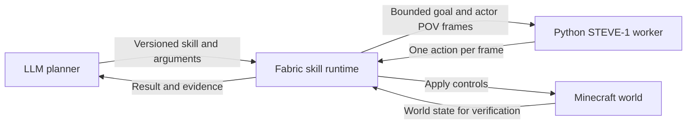

# STEVE-1 integration plan

Use STEVE-1 to carry out short in-game tasks for Ada and Ben. The LLM chooses goals, composes versioned skill trees, and decides how to recover or coordinate. Fabric verifies each outcome from the world state. Start with one existing villager in the graphical Minecraft 1.20.1 client. Test whether it can collect a log as reliably as the current system and whether the new skill interface saves LLM turns on larger goals.

## Baseline and experiment branches

Use `main` at `346fd41` as the reference and branch to `experiment/steve-1` when implementation begins. Use the same world fixtures, goal contract, and benchmark format for later controller experiments.

| Configuration | What it measures |
| --- | --- |
| Existing JSON input programs | The current success rates, runtime, and LLM effort for creating or adapting a skill. |
| STEVE-1 alone | The learned controller's performance on each bounded skill. |
| STEVE-1 with scripted fallback | The results a planner gets with recovery enabled. Report how often the script supplies the successful outcome. |

Libraries and demonstrations are persisted by world and arena. Use copied saves or rebuildable fixtures to keep changed terrain, inventories, and skill revisions from affecting later comparisons. Use one active client or server per live save. [Current workflow and persistence](../README.md)

## Responsibilities and interfaces

- **LLM planner.** Extend the planner's tool set to discover capabilities, compose skills, and react to structured results. Let the STEVE-1 planner profile use named skills with typed arguments. Keep experimental prompt authoring in the developer path while prompts are being evaluated. The planner can try again, choose a documented fallback, change the plan, or ask another actor to help. [AgentLoop](../src/main/java/org/minecraftagents/tools/AgentLoop.java) · [AgentTools](../src/main/java/org/minecraftagents/tools/AgentTools.java)
- **Skill tree and verifier.** Reuse version-pinned calls, conditions, assertions, and failure paths. Add a policy leaf that yields while a short attempt runs. Each leaf declares its capability and version, allowed arguments, preconditions, success predicate, and tick budget. Bind that version to a prompt or visual goal revision and controller profile. Persist definitions and evidence as appropriate. Treat live policy sessions as transient. Keep saved input programs and demonstrations readable. [AgentProgram](../src/main/java/org/minecraftagents/tools/AgentProgram.java) · [AgentSkills](../src/main/java/org/minecraftagents/tools/AgentSkills.java)
- **Policy worker.** Run inference in a local Python process. Load the released VPT model configuration, STEVE-1 checkpoint, MineCLIP encoder, and text prior once. Read one RGB frame and the active goal, then return the decoded MineRL action. Maintain separate recurrent state and random state for each actor attempt. Encode the goal at attempt start. Use the conditional `get_action` path, which takes an observation containing `pov` and a goal embedding. The upstream factory initializes a MineRL environment for validation, so isolate or adapt that initialization for Fabric. [Upstream configuration](https://github.com/Shalev-Lifshitz/STEVE-1/blob/main/steve1/config.py) · [Conditional agent](https://github.com/Shalev-Lifshitz/STEVE-1/blob/main/steve1/MineRLConditionalAgent.py) · [Upstream factory](https://github.com/Shalev-Lifshitz/STEVE-1/blob/main/steve1/utils/mineclip_agent_env_utils.py)
- **Minecraft controls and evidence.** Capture real RGB frames on the graphical client from the controlled actor's eye position and orientation. Use the existing raycast and inventory observations for planning and checks. Expand the input adapter to apply simultaneous movement, camera, and interaction inputs on the server thread. Start with movement, jump, look, and block attack. Add use and hotbar selection when a tested skill needs them. [AgentVision](../src/main/java/org/minecraftagents/tools/AgentVision.java) · [AgentInput](../src/main/java/org/minecraftagents/tools/AgentInput.java)

For example, `gather_oak_log@1` checks inventory capacity, uses a tested tree-chopping prompt, and stops when the actor's oak-log count increases by one relative to the start of the call. If the actor already has enough logs, a parent plan can check stock and skip gathering. If the actor breaks a log and times out before pickup, return the current inventory and any observed drop so the planner can decide how to recover.

### Frame and action lifecycle

1. Open a session with a protocol version, dimension, actor UUID, attempt ID, and pinned controller configuration. Start when the renderer, worker, and actor are ready. Give each actor one active input owner across policy runs, scripted runs, and direct input.
2. Send the actor's RGB frame with a world tick and frame sequence. Target one decision per simulation tick at 20 Hz. Keep a bounded queue with one frame in flight per actor. Run capture readback, transport, and inference without waiting on the server tick thread. Start with a local, length-bounded binary frame stream and structured control messages.
3. Accept a reply once for its matching attempt and target tick. Apply neutral input on a miss and count it. Discard late, duplicate, and out-of-order replies. End the attempt on sustained frame gaps or a camera change. Preserve mining progress across consecutive attack ticks against the same target. Release it when attack ends or the target changes. Verify fractional camera deltas, pitch/yaw order and sign, and combined actions against the upstream mapper.
4. End on verified success, a tick or wall-clock deadline, a stall limit, `/agent stop`, worker or renderer loss, actor removal, or world unload. Release ownership and held input, invalidate pending replies, and clear recurrent state. Report success, unmet goal, precondition failed, timeout, cancellation, or controller unavailable, with elapsed ticks, inventory changes, and last observed progress. Attach the calling skill path to failed leaves. Each retry opens a fresh session against the current world state and spends from the parent plan's remaining budget.

## Implementation sequence

| Phase | Work and acceptance check |
| --- | --- |
| **1. Reproduce upstream inference** | Run the official custom-text example with `look at the sky`, then reproduce tree chopping with the released checkpoint. Start with the documented Linux/Python 3.10 environment and CUDA. Use WSL2 or a Linux GPU host if that fits the development setup, and benchmark the intended deployment path. Pin the upstream commit, dependencies, and weight hashes. Then feed recorded RGB frames through the conditional policy with the Fabric adapter and verify decoded actions with no live MineRL simulation. [Setup](https://github.com/Shalev-Lifshitz/STEVE-1#setup) · [Weight downloads](https://github.com/Shalev-Lifshitz/STEVE-1/blob/main/download_weights.sh) · [Reference runner](https://github.com/Shalev-Lifshitz/STEVE-1/blob/main/steve1/run_agent/run_agent.py) |
| **2. Prove the camera and controls in Fabric** | Capture a known scene from Ada's view and validate orientation, RGB order, dimensions, crosshair, and alignment with the server raycast. Compare with a first-person player feed to isolate villager-specific differences. Match upstream capture settings where practical, including 640×360 source frames and resize to 128×128. Use a fake worker to test turns, move-and-attack, mining holds, missed replies, cancellation, and unload. Then run a live sky-looking attempt through the test harness. [Upstream view settings and actions](https://github.com/Shalev-Lifshitz/STEVE-1/blob/main/steve1/VPT/agent.py) |
| **3. Measure basic skills** | Expose a developer command such as `/agent policy Ada gather_oak_log`. Build fixtures for looking up, collecting a log, and collecting dirt on a designated ground patch. Test stop, restart, and busy-actor handling. Compare the policy with scripted runs on the same fixtures. If performance drops, compare upstream MineRL, the Fabric player calibration feed, and Fabric villager runs before tuning prompts or changing controls. |
| **4. Connect the LLM and library** | Add versioned policy leaves, planner capability discovery, typed outcomes, and bounded recovery. Connect the execution path to existing skill start, status, stop, and debug commands. Test a nested leaf failure, a partial-start retry, and reopening a save with old and new skill versions. Compare a planner-driven task with today's workflow using the same LLM and turn budget. |
| **5. Test community workflows** | Run Ada and Ben in one arena with independently identified views, worker sessions, and inventory evidence. Start with assigned roles and one policy actor at a time, then test parallel runs and conflicting claims on the same tree or drop. Use a verified shared deposit or handoff once world interactions support it. Measure renderer and GPU capacity as actor count rises. For console worlds, evaluate a companion rendering client or off-screen renderer and report policy availability through status. |

## Benchmark and promotion criteria

Freeze prompts and budgets before scoring. Pair configurations on at least 30 held-out starting states per skill for the first comparison. Vary starting yaw, distance, line of sight, partial progress, and arena versus outdoor terrain. Include separate negative cases such as an absent target or full inventory to verify recovery. Use the same success predicates and total time budget for each configuration. Record the world fixture, policy seed, checkpoint, renderer settings, and skill version. Report success counts and uncertainty, median and p95 completion time, LLM turns and tokens, GPU memory, tick deadline misses, unintended world edits, and fallback use.

| Test | Proposed initial acceptance target |
| --- | --- |
| Look up | Pitch reaches −60° or lower within 300 ticks in at least 90% of trials. Minecraft uses negative pitch for looking up. |
| Gather wood and dirt | For each task, the named inventory count increases by at least one within 1,200 ticks. Target at least 80% success and a gap of at most 10 percentage points below the scripted baseline. Report STEVE-1-only and fallback results independently. |
| Runtime | Target at least 95% of one-actor decisions arriving in time for the next scheduled tick. Verify zero stale actions applied after stop, restart, or unload. Compare server tick performance with the worker and capture enabled and disabled. |
| Planner | On a goal such as meeting a log stock target while handling a missing tree or existing drop, target a 25% reduction in median LLM turns at comparable success. Use fresh goal variants so the comparison measures planning effort. |
| Collaboration | Each actor receives its own observations and outcomes. A conflicting resource claim yields bounded recovery, and the team goal is verified from the final world state. |

Promote capabilities individually. Where STEVE-1 misses the target, keep that capability scripted or try another controller behind the same skill contract. A slow but effective controller can still support turn-based experiments while real-time performance is investigated.

## Risks to resolve early

| Risk | Early test or mitigation |
| --- | --- |
| **The training environment differs from our villagers.** MineRL 1.x uses Minecraft 1.16.5. Our Fabric 1.20.1 actors have villager eye height, movement, and inventory. Camera presentation, reach, and timing can all affect success. | Use the upstream player, Fabric player, and Fabric villager comparison to isolate failures. If the gap is specific to villager control semantics, evaluate a player-controlled embodiment as a separate experiment. [MineRL version history](https://minerl.readthedocs.io/en/latest/notes/versions.html) · [Current actor controls](../src/main/java/org/minecraftagents/tools/AgentInput.java) |
| **A good prompt can still fail or do extra work.** The paper shows prompt sensitivity and uses longer evaluation runs than the proposed local skill budget. Its visual prompt chains reached 70% for crafting planks and 50% for tower building in the reported setup. | Verify each leaf against world state and stop on success. Pin tested prompts, bound retries, and report unintended edits. Treat crafting and precise placement as additional capabilities that need their own control and verification tests. [STEVE-1 paper](https://arxiv.org/html/2306.00937) |
| **Missing input capabilities can distort behavior.** The upstream action space includes inventory and sprint/sneak, and current villager controls have a smaller action set. | Count unsupported actions and record their effect on skill completion. Test inventory UI, hotbar semantics, and crafting separately before exposing goals that depend on them. [Upstream action space](https://github.com/Shalev-Lifshitz/STEVE-1/blob/main/steve1/VPT/agent.py) |
| **Headless and multi-actor runs need rendering capacity.** The console launcher starts a server, so STEVE-1 needs an added source of pixels. Rendering from several actors and running recurrent inference can consume the tick budget. | Establish capture-to-action latency with one actor. Test a renderer companion for console operation, then measure frame rate and GPU memory with two actors before expanding concurrency. [Console bootstrap](../src/main/java/org/minecraftagents/console/ConsoleBootstrap.java) |
| **Weight availability and reuse terms can affect distribution.** The upstream download script uses separate model artifact hosts, and terms for STEVE-1 code and checkpoints need confirmation. | Confirm STEVE-1 and underlying component terms before vendoring or redistribution. Record artifact origins and hashes. Store weights and dependency environments outside Git. [Upstream source tree](https://github.com/Shalev-Lifshitz/STEVE-1/tree/main) · [Artifact URLs](https://github.com/Shalev-Lifshitz/STEVE-1/blob/main/download_weights.sh) |
